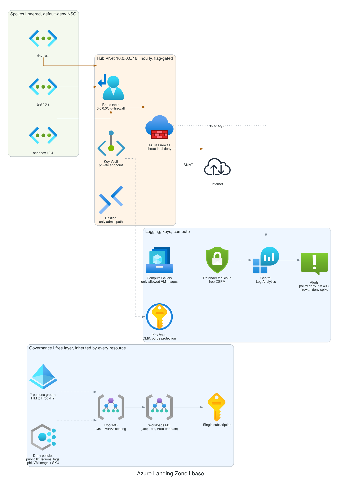
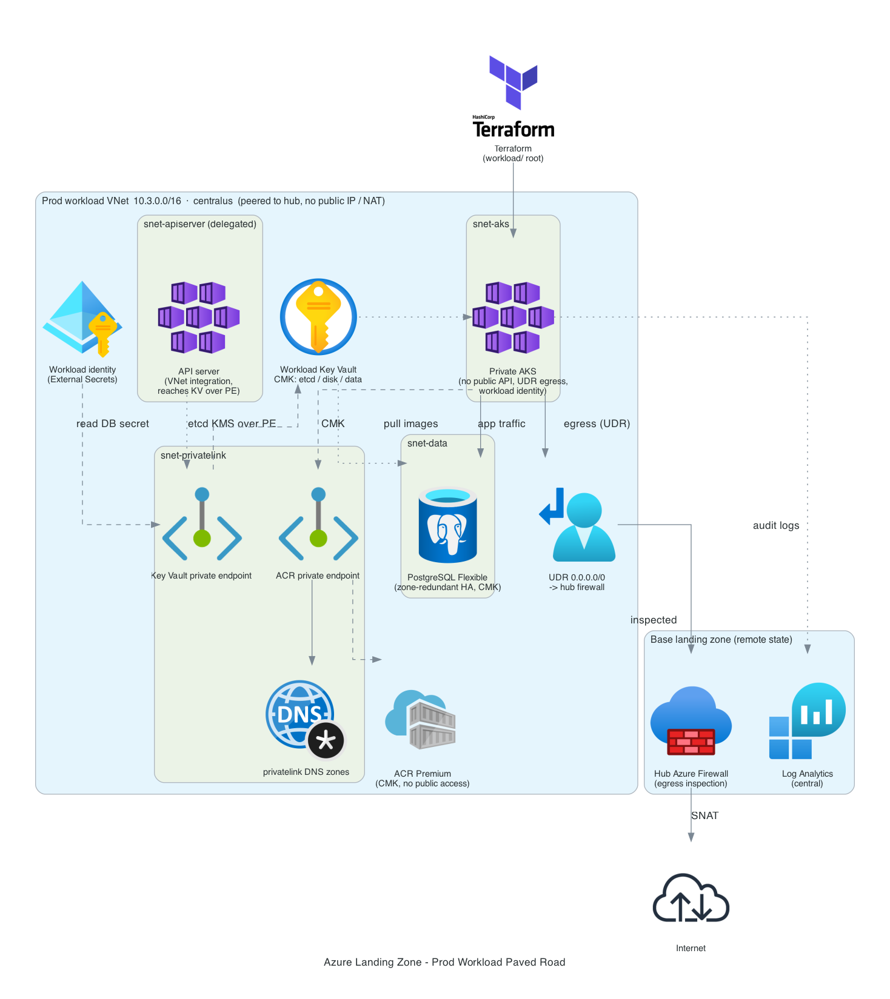
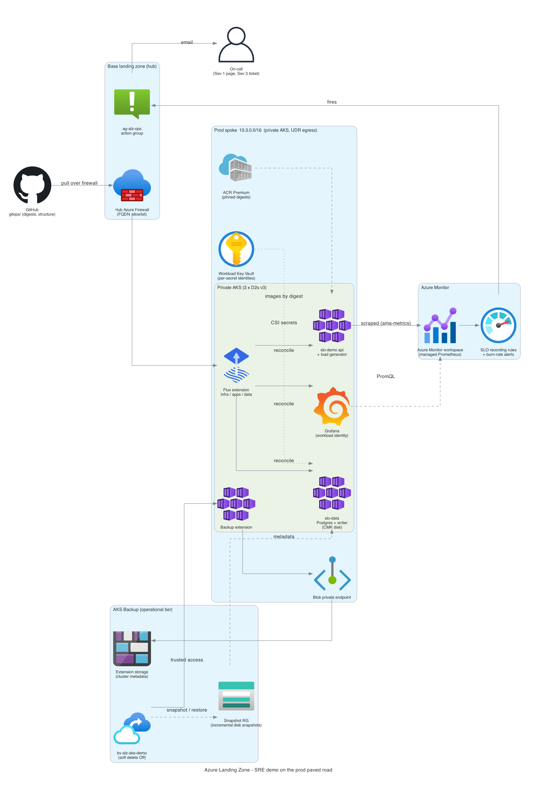
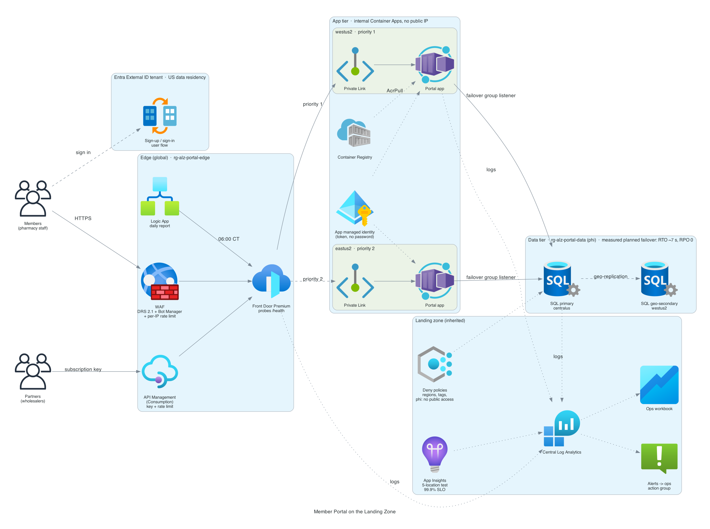

# Azure Landing Zone

A standalone, best-practice Azure landing zone built with bespoke Terraform: a
management-group hierarchy with preventive (Deny) policy guardrails and the
built-in CIS initiative, a hub-and-spoke network with centralized Azure Firewall
egress inspection and Bastion-only admin access, private endpoints, central
logging with Defender for Cloud, a CMK-backed Key Vault, and least-privilege Entra
identity with just-in-time elevation to Prod. It is one of three isolated landing
zones (AWS, Azure, GCP) in this portfolio; the three do not communicate.

## Architecture



Read it left to right. Every spoke's default route points at the hub firewall,
so the only way out is Azure Firewall with threat-intel deny, then SNAT. Bastion
is the only admin path and no workload holds a public IP. Governance (bottom)
is the free layer: Deny policies and persona RBAC attach at the root management
group, and the single subscription inherits them through Workloads. The hub
(orange) bills by the hour and comes up only behind flags. The prod spoke
belongs to the separate [workload root](#workload-paved-road-prod-tier-workload).

## The problem it solves

A subscription with no landing zone lets anyone create anything, anywhere, with no
tags, public IPs on demand, admin ports open to the internet, secrets in code, and
no central log of what happened. This repo is the governed foundation a workload
lands **into**: the guardrails are attached at the hierarchy so every current and
future resource inherits them, the network forces all egress through one inspected
chokepoint, the only admin path is Bastion, and the whole thing is scored against
the CIS Azure Foundations Benchmark. It stands up, proves its guardrails deny, and
tears down under a fixed budget.

## Key decisions

**Bespoke Terraform instead of the ALZ accelerator.** Every management group,
Deny policy and route here is a resource I wrote and can explain line by line;
an accelerator hides those decisions behind a variable file. It also keeps the
three landing zones structurally parallel and lets every hourly resource sit
behind a flag. At real scale I would adopt the AVM enterprise-scale module and
keep only the custom parts. [accelerator-vs-bespoke](docs/accelerator-vs-bespoke.md).

**One subscription, tiered by management group and resource group.** There is
no EA or MCA to vend more. The cost is blast-radius isolation and stricter Prod
policy, which is spelled out in [the next section](#single-subscription-by-design)
rather than hidden.

**A scoped carve-out instead of a weaker policy.** Deny-public-IP applies to the
whole subscription except the hub resource group, where the firewall and Bastion
need public IPs. Every workload spoke stays denied.

**No SIEM and no paid Defender plans by default.** Sentinel bills per GB on top of
Log Analytics and has no value in a stack that lives for hours. The paid Defender
plans sit behind one flag, and the findings export is wired already, so turning a
plan on needs no further Terraform. The gap is stated plainly: nothing here
watches behaviour. [ADR-0004](docs/adr/0004-detection-tier.md).

**Just-in-time Prod access behind a license flag.** PIM needs Entra ID P2. Without
it the persona groups and MG-scoped RBAC still deploy, and the JIT wiring waits
behind `enable_pim`.

## What the live runs found

Plans and `validate` were clean for every one of these. Each surfaced only on a
real deploy, image bake or teardown in Azure.

1. **Private KMS for AKS needs API Server VNet Integration.** Encrypting etcd with
   a Key Vault reached over a private endpoint failed until the cluster got a
   delegated `/28` API server subnet.
2. **AKS could not approve its own private endpoint.** AKS creates a managed
   private endpoint to the vault for KMS, and the create failed with
   `LinkedAuthorizationFailed`. Fixed with a least-privilege custom role that can
   only approve private endpoint connections on that vault.
3. **The default-deny NSG blocked Postgres HA.** The zone-redundant standby could
   not replicate (`VnetReplicationToPrimaryNetworkBlocked`) until the data
   subnet allowed 5432 inside itself.
4. **A role assignment worked only at a wider scope.** The Postgres backup role
   includes `resourceGroups/read`, which takes effect only when assigned at
   resource group scope, so the assignment on the server failed with
   `AuthorizationFailed`.
5. **Regions said no.** eastus was restricted for Postgres on this subscription,
   so the zone moved to centralus. Later centralus refused new AKS clusters
   (`AKSCapacityHeavyUsage`), and the AKS proof ran in eastus2.
6. **Teardown has a 14-day floor.** The backup vault's soft delete is always on
   and has no purge, so a deleted backup instance blocks the policy and vault
   from deleting until retention expires.
7. **The first golden image failed its own hardening check.** Apport reset
   `fs.suid_dumpable` at boot. Release `v2.0.1` of azure-vm-hardening removes
   Apport and re-verifies after a reboot before publishing.
8. **The first CI sign-in was rejected.** `azure/login` failed with
   `AADSTS700213: No matching federated identity record found for presented
   assertion subject 'repo:jordann6@196278615/azure-landing-zone@1407358203:ref:refs/heads/main'`.
   GitHub issues this repo's tokens with the immutable subject (owner and repo
   IDs), and Entra matches a federated credential's subject exactly. The AWS zone
   had already hit the same mismatch; the Azure credentials were still written
   from the old name-based pattern. They now trust the immutable form, which also
   means a deleted and recreated repo with the same name cannot inherit the trust.

The drift proof and the [SRE demo session](#sre-demo-gitops-slos-and-a-restore-drill)
on 2026-10-29 added these, and a second, shorter session that evening proved the
fixes for 20 and 21 and found 22 and 23.

9. **The shared drift check cried wolf.** `terraform plan -refresh-only
   -detailed-exitcode` returned 2 on azurerm with an empty `resource_drift`, so
   every clean run of platform-guardrails `tf-drift` v1.8.1 opened a drift issue
   listing 0 resources. The fix (platform-guardrails PR #12) decides drift from
   `resource_drift`; `drift.yml` pins it by SHA.
10. **A fresh cluster create was denied its own KMS key, twice.** "Access to
    KeyVault ... was denied when using KMS", 13 minutes apart. The control-plane
    identity's vault read came only from a custom role that replicates slowly.
    Fixed with the built-in Reader on the vault and a 5-minute propagation wait.
11. **No pod could pull from the private registry.** The kubelet identity had no
    AcrPull. The 2026-10-06 proof never pulled an app image, so it never showed.
12. **Two nodes were not enough.** The add-ons alone requested about 1.95 of the
    1.9 allocatable vCPU per D2s v3 node, and the AKS Backup extension's Helm
    install timed out. Three were not enough either (finding 22); the default is
    now 4.
13. **Docker Hub and ECR Public both rate-limited ACR import (429)** through the
    shared egress. Postgres is mirrored to ghcr.io by digest and imported from there.
14. **The backup extension needs a role the docs leave out.** The instance sat in
    `ProtectionError` until its identity got Storage Account Contributor (for
    `listKeys`); the Learn prerequisites table lists only Blob Data Contributor.
15. **`az aks command invoke` fails every call in Azure CLI 2.83.0** ("Operation
    returned an invalid status 'OK'"). The drills call the runCommand REST API,
    which on an Entra cluster also needs a clusterToken.
16. **`az k8s-configuration flux update --suspend` alone is rejected.** It has to
    resend `--kind git --url --branch`.
17. **A polling helper hid a fired alert and a Flux revert.** `wait_until` expanded
    its `$(...)` condition once, at the call, and retested the same value forever.
    It now evaluates the condition on every poll.
18. **Checkov's HCL parser drops a whole file on an attribute named `for`.** The
    alert rules carry their hold time in range vectors instead.
19. **A recovery point is older than its timestamp.** `recoveryPointTime` was
    17:40:54, but the newest recovered write was from 17:38:27. Data loss is
    measured from the last recovered write.
20. **Teardown cut the cluster's network out from under it.** Terraform deleted the
    hub peerings and the Key Vault private endpoint before the cluster, because
    nothing ordered them. Nodes lost egress and went NotReady, and the Flux
    configuration and backup instance deletes hung 30 minutes and failed. The
    cluster now depends on its whole network path, and `make check-destroy-order`
    (also a CI job) fails on a missing edge. Proven in a second session the same
    evening: the Flux configuration deleted in 1m03s and the backup instance in
    1m54s, the cluster went next (6m46s), and only then the peerings and private
    endpoints. 98 resources in 23 minutes, no manual step.
21. **The FQDN allowlist was mostly moot.** Network rules are evaluated before
    application rules, and an `AzureCloud.<region>:443` network rule carried 2874
    connections, Monitor ingestion among them. The backup extension's FQDN rule
    had zero hits. A private cluster needs none of those ports, so the rule is now
    the documented `AzureMonitor:443`, and the backup wildcards are gone. Proven in
    the second session: that rule carried 2,025 connections, the FQDN rules now
    match by name, and Flux, Container Insights, managed Prometheus, Azure Policy
    and an on-demand AKS Backup (4m06s) all worked. The firewall denied what it
    should: grafana.com, usage.projectcalico.org, cdn.fwupd.org, and the
    `md-*.blob.storage.azure.net` endpoints Microsoft documents as safe to block.
22. **Three nodes were not enough either.** The add-ons and the Flux apps fit, but
    the AKS Backup agent's Velero container requests 520m and the largest free
    slice was about 440m ("0/3 nodes are available: 3 Insufficient cpu"). The
    extension's Helm install timed out before a fourth node joined. The default is
    now 4.
23. **A backup instance checks its permissions once.** Created 31 seconds after
    the extension identity's Storage Account Contributor role, the instance failed
    `listKeys` with a 403 and stayed in `ProtectionError`, although the role was
    in place and Velero's storage location went Available minutes later. Only a
    recreated instance recovered. A 5-minute `time_sleep` now sits between the
    backup role assignments and the instance, the same pattern as the cluster's.

## How Azure differs from the AWS and GCP zones

Same design contract, three different control planes:

- **Hierarchy**: Azure uses **management groups** (+ resource groups in this
  single-subscription demo) where AWS uses **Organizations OUs/accounts** and GCP
  uses **folders/projects**. The intended subscription-per-tier split is documented
  in [access-model.md](docs/access-model.md).
- **Preventive guardrails**: **Azure Policy with Deny effects** and the built-in
  **CIS initiative**, where AWS uses **SCPs** and GCP uses **org policies** applied
  at the org root.
- **Egress inspection**: **Azure Firewall + a UDR** forcing `0.0.0.0/0` through it,
  where AWS uses a **Network Firewall in an inspection VPC off a Transit Gateway**
  and GCP uses **Cloud NAT + hierarchical firewall policies**.
- **Admin path**: **Azure Bastion** (no public VM IPs), where AWS uses **SSM
  Session Manager** and GCP uses **IAP-only SSH**.
- **Identity/JIT**: **Entra ID groups + PIM**, where AWS uses **IAM Identity Center
  permission sets** and GCP uses **Cloud Identity + IAM Conditions**.

## Single subscription by design

This zone runs in one subscription, because there is no EA or MCA to vend more.
The subscription sits under the Workloads management group, so it inherits every
assignment at the root and at Workloads. The Dev, Test, Prod and Sandbox
management groups exist and carry their tier-specific assignments (the Prod
single-region location policy, standing Reader plus PIM-eligible Contributor at
Prod), but with no subscription beneath them those assignments bind nothing in
this demo. They take effect once each tier has its own subscription. Resource
groups separate each tier's resources but do not receive tier policy.

What that costs is blast-radius isolation and tier-specific enforcement: a
subscription-level mistake reaches every tier, and Prod is governed exactly like
the rest of Workloads, not more strictly. The intended subscription-per-tier
layout and the reusable `landing-zone` spoke module are in
[access-model.md](docs/access-model.md).

## Parity with the AWS and GCP zones

Status as of 2026-10-29. "Built" means code merged or committed. "Proven" means a
deploy-test-destroy session passed. Where a cell says pending, nothing was run. AKS and ACR on azurerm 4.x were proven 2026-10-06 in eastus2 (centralus refused new AKS clusters with `AKSCapacityHeavyUsage`): clean post-apply plan, private VNet-integrated cluster with private KMS, ACR behind its private endpoint with CMK and the cache rule.

| Capability | AWS | Azure | GCP |
|---|---|---|---|
| Isolation boundary | Accounts per tier | One subscription, management groups and resource groups | Project per tier |
| Preventive guardrails | SCPs, proven denials | Azure Policy Deny, proven denials | Org policy and custom constraints, proven denials |
| Central audit log | Org trail, Object Lock | Activity log to Log Analytics | Org sinks to BigQuery and a log bucket |
| Network flow logs | Built | Proven 2026-10-06 (hub and prod, CMK storage, Traffic Analytics), behind `enable_flow_logs` | Built (subnet flow logging, 50% sampling) |
| Observability layer | Own root, cross-account, retained | Own root, proven 2026-10-06, not retained (workspace lives in the base) | Sinks and CIS alert metrics in the base, ops layer queued |
| Findings routing | HIGH and CRITICAL to SNS | Defender export to the workspace, quiet on the free tier | SCC to Pub/Sub, off in the recorded deploy |
| Threat detection | GuardDuty | Not enabled, see [ADR-0004](docs/adr/0004-detection-tier.md) | SCC, activation is manual |
| Compute baseline | Guardrails live, compute proven 2026-10-06 | Image and VM proven 2026-10-05 | Code complete, live run pending |
| Dedicated state backend | Built | Built | Built |
| Gated CI apply and destroy | Proven 2026-10-15 on the full hourly stack (196 resources) | Proven 2026-10-26 on the `ci-proof/` root only, see [CI](#ci) | Shared workflows support WIF, activation pending |
| Drift detection | Daily on the accounts root, proven 2026-10-26 | Daily on `ci-proof/`, proven 2026-10-29 (clean run, a CLI tag change opened issue #13 naming the VNet, the revert closed it) | Not wired |
| GitOps | Not built | Flux extension on the private AKS, proven 2026-10-29 (manual scale reverted in 29s, a commit live in 63s with no kubectl) | Not built |
| SLO alerting | Not built | Managed Prometheus, multiwindow burn-rate rules, proven 2026-10-29 (`SloFastBurn` paged 5m28s after a 50% fault) | Not built |
| Kubernetes backup | Not built | AKS Backup operational tier, restore proven 2026-10-29 (namespace deleted, writes resumed in 405s, 294 writes lost) | Not built |
| Secrets scanner | Live | Identity, alert and positive control proven 2026-10-06 (metadata-only role, 403 on value read, NearExpiry alert); the Rails scanner itself is not run here | None |
| Warm standby | Not started | Member portal only: two-region app and SQL failover group, planned failovers measured 2026-10-03. Prod LZ tier has in-region zone HA and geo-redundant backup only | None |

The gaps that remain on the Azure side are the missing threat-detection service
and the single-subscription boundary. Both are deliberate and written up, not
oversights.

## What gets built, by tier and pillar

**Governance (free layer).**
- Management-group tree: root → Platform, Workloads (Dev, Test, Prod), Sandbox
  (`terraform/main.tf`). The subscription is associated to Workloads, so root
  and Workloads assignments apply to it; the Dev, Test, Prod and Sandbox groups
  have no subscription and their assignments bind nothing yet.
- Preventive **Deny** policies at the hierarchy: deny public IP, allowed locations
  (a tighter Prod assignment is wired at the Prod group, inert until Prod has its
  own subscription), and required tags (`owner`, `cost_center`, `environment`,
  `data_classification`) (`terraform/policies.tf`). The deny-public-IP assignment
  excludes the hub resource group (`not_scopes`), where the firewall and bastion
  legitimately hold public IPs: in the intended multi-subscription design the hub
  sits under Platform and is out of scope, but this single-subscription demo
  associates the whole subscription to Workloads, so the hub needs an explicit
  carve-out while every workload spoke stays denied.
- The built-in **CIS Microsoft Azure Foundations Benchmark** initiative assigned at
  root, scored in Defender for Cloud. See [cis-mapping.md](docs/cis-mapping.md).

**Identity.**
- Seven least-privilege Entra persona groups bound at MG scope; **no standing write
  to Prod** (platform engineers are PIM-eligible for Contributor, JIT only)
  (`terraform/identity.tf`, [access-model.md](docs/access-model.md)). PIM eligibility
  needs an Entra ID P2 license, so a tenant without P2 deploys with `enable_pim =
  false`: the persona groups and MG-scoped RBAC still apply, and the JIT-to-Prod
  wiring stays in `identity.tf` behind the flag for a P2 tenant.

**Networking (hourly, flag-gated).**
- Hub VNet `10.0.0.0/16` with correctly named/sized reserved subnets.
- **Azure Firewall** (Standard, threat-intel Deny) with a route table forcing every
  spoke's `0.0.0.0/0` through it (`terraform/firewall_azure.tf`).
- **Azure Bastion** as the only admin path (`terraform/bastion.tf`).
- **Private endpoints + private DNS** for the Key Vault (`terraform/private_endpoints.tf`).
- Three tier spokes (dev `10.1`, test `10.2`, sandbox `10.4`), each peered to the
  hub with a **default-deny NSG** on its workload subnet (`terraform/network.tf`,
  `terraform/modules/landing-zone`). The prod tier (`10.3`) is owned by the separate
  workload root (see below), which stands up the prod VNet and peers it to this hub,
  so the base does not vend a prod spoke.
- An **opt-in FortiGate NVA** is the alternative third-party egress path
  (`terraform/firewall.tf`), mutually exclusive with Azure Firewall.

**Logging, monitoring, encryption, cost.**
- Central **Log Analytics** workspace in its own resource group, receiving the
  subscription **Activity Log**, Key Vault audit events, **Azure Firewall rule
  logs** (resource-specific `AZFW*` tables), and **Bastion session audit**;
  **Defender for Cloud** free CSPM renders the CIS and HIPAA assessments
  (`terraform/monitoring.tf`).
- **Alerting** through one action group: any Deny policy event, any Key Vault 403,
  and a firewall deny spike (`terraform/alerts.tf`). The matching investigation
  queries are saved in [docs/kql/](docs/kql/).
- **Observability root** (`observability/`, its own state, applied after the base):
  13 control-plane change alerts (policy assignment, NSG and rule, firewall policy,
  security solution, role assignment, Key Vault delete; the CIS 5.2.x set plus a few
  more) and Defender for Cloud continuous export of High alerts and assessments into
  the central workspace, with an alert on High findings. The free CSPM tier produces
  recommendations only, so the High-alert path stays quiet until a paid Defender plan
  is on. `make deploy-observability`, then `make test-observability`.
- **VNet flow logs** for the hub and prod VNets with traffic analytics, behind
  `enable_flow_logs` (`terraform/flow-logs.tf`). `make test-flow-logs`.
- **Key Vault** with purge protection + soft delete + default-Deny network ACL, and
  a **CMK with a rotation policy** (`terraform/keyvault.tf`).
- A monthly **budget** with actual + forecast alerts (`terraform/budgets.tf`).

**HIPAA technical safeguards.**
- The built-in **HITRUST/HIPAA** initiative at the root management group, scoring
  only (`enforce = false`), so Defender for Cloud scores every tier against HIPAA
  next to CIS.
- `data_classification` limited to `public`, `internal`, `confidential`, `phi` by
  a Deny policy, and a resource group tagged **`phi`** cannot hold a Key Vault,
  storage account, SQL server, or PostgreSQL server with public network access
  (`terraform/hipaa.tf`). See [docs/hipaa-mapping.md](docs/hipaa-mapping.md).

## Workload paved road (prod tier, `workload/`)



The prod VNet has no public IP or NAT. The private AKS cluster reaches its
registry and Key Vault only through private endpoints, encrypts etcd with a key
over the vault's private endpoint, and sends all other egress through the hub
firewall in the base landing zone.

A separate Terraform root (`workload/`, its own state) is the prod paved road, the
hourly-billed layer that lands in the prod tier (`10.3`) and is deployed for a demo
then destroyed on its own. It mirrors `aws-landing-zone/workload` (EKS to AKS),
reading the base landing zone over remote state (the hub VNet, the firewall private
IP, the Log Analytics workspace) and peering the prod VNet to the hub.

| Control | What it is |
|---|---|
| Cluster | **Private AKS**: no public control plane, egress only through the hub firewall (`outbound_type=userDefinedRouting`), CMK envelope encryption of etcd secrets (Key Vault KMS), CMK node disks (disk encryption set), Entra RBAC with local accounts disabled, control-plane audit logs to Log Analytics (`workload/aks.tf`). |
| Pod identity | **Workload identity** (OIDC), the IRSA analog: the External Secrets Operator service account federates to an Entra identity scoped to read only the DB secret (`workload/workload-identity.tf`). |
| Data | **PostgreSQL Flexible**, zone-redundant HA, VNet-injected (private), CMK storage, Entra auth, credential in Key Vault (`workload/postgres.tf`). |
| Registry | **ACR Premium**: no public access, CMK, private endpoint, MCR pull-through cache, the only sanctioned image source (`workload/acr.tf`). |
| Private access | Private endpoints + private DNS for ACR and Key Vault, so the private cluster pulls images and reads secrets with no internet path (`workload/private-endpoints.tf`). |
| Backup | Geo-redundant Backup vault with soft delete, protecting the database (`workload/backup.tf`). |
| Network | Prod VNet `10.3`, no public IP/NAT, egress `0.0.0.0/0` to the hub firewall, app/data NSGs (`workload/network.tf`, `workload/segmentation.tf`). VNet flow logs (`workload/flow-logs.tf`) follow the base `enable_flow_logs` flag. |

Because a private AKS cluster with UDR egress cannot provision unless the firewall
permits AKS's required destinations, `workload/aks-egress-firewall.tf` attaches an
`AzureKubernetesService` FQDN-tag rule collection to the base firewall policy.

Deploy it after the base (with the hourly firewall up): `make deploy-workload`, tear
it down first with `make destroy-workload`.

### SRE demo: GitOps, SLOs and a restore drill



Two flags on the workload root, both off by default, turn the paved road into
something an on-call engineer would recognise. `enable_sre_demo` adds the Flux
extension reconciling `gitops/` from this repo (a .NET 10 service with a load
generator, Grafana, and a Postgres StatefulSet on CMK disks), managed Prometheus
into an Azure Monitor workspace, and SLO recording and burn-rate alert rules that
page through the base action group. `enable_aks_backup` adds an operational-tier
AKS Backup vault for the stateful namespace. Images are pinned by digest; secrets
come from Key Vault through the CSI driver, one workload identity per consumer.

Sessions of 2026-10-29, eastus2: the drill session (about 3.5 hours of hourly
resources, estimated $7 to $9.50) and a proof session that evening (about 2.3
hours, estimated $6 to $7.50). Cost Management had not posted when this was written.

| Drill | Result |
|---|---|
| GitOps (`make drill-gitops`) | Flux Compliant on infra, apps and data. A manual `kubectl scale` 3 to 1 reverted by kustomize-controller in 29s. A commit (load generator 20 to 25 rps) live in 63s with no kubectl. |
| SLO (`make drill-slo`) | 50% fault injected at 17:02:36. `SloFastBurn` fired at 17:08:04 (5m28s; evaluated 0.077 against 0.072) and the page email arrived by 17:10. Fault removed at 17:11:45, alert resolved at 17:23:02. |
| Restore (`make drill-restore`) | Namespace deleted at 17:43:35. Restore job 219s, Postgres Ready at +316s, writes resumed at +405s. Last durable write 3301, recovered 3007 with no gaps: 294 writes lost. Flux resumed Compliant with no diff. |
| Add-ons | Container Insights wrote 2153 KubePodInventory rows in 15 minutes; Azure Policy reported 9 states. |
| Proof session (same evening, 4 nodes) | Narrowed egress: `AzureMonitor:443` carried 2,025 connections; Flux Compliant, 2,364 KubePodInventory rows in 15 minutes, 21 Prometheus targets up, an on-demand AKS Backup completed in 4m06s. Teardown: 98 workload resources in 23 minutes in dependency order, verify-teardown PASS. |

What the session found is in [What the live runs found](#what-the-live-runs-found),
items 10 to 23. The SLO spec is [docs/slo.md](docs/slo.md), the runbooks are in
[docs/runbooks/](docs/runbooks/), the priced session plan with stop conditions is
[docs/sre-session.md](docs/sre-session.md), and the two design calls are
[ADR-0005](docs/adr/0005-sre-metrics-path.md) (metrics path) and
[ADR-0006](docs/adr/0006-aks-backup-operational-tier.md) (backup tier).

## Member portal (`portal/`)



Members reach the app only through Front Door and its WAF, which routes over
Private Link to internal Container Apps in two regions. Both regions write
through one SQL failover group listener, so the app never needs to know
which database is primary. Partners come in through API Management.

A second workload, shaped like the stack a member-services organization runs:
**Front Door Premium with WAF** in front of **Container Apps in two regions**
(internal, no public IP, reached over Private Link), **Azure SQL with a failover
group** (private endpoints, Entra-only auth, phi-classified), **API Management**
for partners, **Entra External ID** for member sign-in, a **Logic App**
integration, and **Application Insights** with an availability test, a 99.9%
SLO burn-rate alert, and an operations workbook. A drill script measures
failover RTO and RPO instead of claiming them. Design, trade-offs, and runbook:
[docs/portal.md](docs/portal.md).

## State backend (`bootstrap/`)

State lives in a backend this landing zone owns, created and hardened by
`bootstrap/`, the one layer that stands between sessions. Why it moved off the
shared account, and the trade-offs: [docs/adr/0001-dedicated-state-backend.md](docs/adr/0001-dedicated-state-backend.md).

| Control | How it is met |
|---|---|
| Destruction protection | `prevent_destroy` on the account and vault, a `CanNotDelete` lock on `rg-alz-tfstate`, and `make destroy` never touches `bootstrap/` |
| Versioning | Blob versioning plus 30-day blob and container soft delete |
| Encryption | Customer-managed key in a dedicated vault, rotated every 90 days, plus infrastructure encryption |
| Access and transport | HTTPS only, TLS 1.2, no public blobs, shared keys disabled (Entra ID + RBAC only) |
| Locking | Native blob lease in the azurerm backend |

`bootstrap/` also owns the two CI identities and `rg-alz-ci` (see [CI](#ci)), so
the trust CI runs on is only ever changed by an operator apply.

One-time move off the old backend:

```bash
cp bootstrap/example.tfvars bootstrap/terraform.tfvars   # set deployer_ip_cidrs
make bootstrap-state                                      # saved plan, against the old backend
terraform -chdir=bootstrap apply bootstrap.tfplan
make migrate-state                                        # copies each root, fails on a count mismatch
```

## Deploy

Credentialed applies run locally (`az login`), plan-before-apply. The deploy is two
steps so the free layer stands up first and the hourly network layer is a separate,
explicit confirmation.

```bash
az login && az account set --subscription <id>

# Copy the example, set deployer_ip_cidrs to your workstation IP so the CMK can be
# created (curl -s https://ifconfig.me), then:
cp terraform/example.tfvars terraform/terraform.tfvars   # gitignored

# 1) Free layer: MGs, Deny policies, CIS, identity, logging, Key Vault CMK
make deploy            # apply with enable_firewall/bastion/private_endpoints = false

# 2) Hourly layer, after reviewing the plan and cost:
make deploy-network    # Azure Firewall + Bastion + UDR + private endpoints
```

## Test (prove the guardrails deny)

```bash
make test    # scripts/test-guardrails.sh
```

It does not just check that apply succeeded. It asserts that Azure **refuses**: a
public IP (deny_public_ip), a resource group in a disallowed location
(allowed_locations), an untagged resource group (require-tag), a resource group
with an unknown `data_classification`, and a storage account with public network
access inside a `phi` resource group, each returning `RequestDisallowedByPolicy`;
that the CIS and HITRUST/HIPAA initiatives are assigned; and that Bastion is the
admin path. It prints pass/fail per check and cleans up anything it created.

## Destroy

```bash
make destroy    # terraform destroy, then scripts/verify-teardown.sh
```

`verify-teardown.sh` fails if any hourly-billed resource (Firewall, Bastion,
Standard public IPs, VMs, private endpoints) is still alive.

## Cost and teardown traps

- **Standing after destroy**: ~$1/mo. The Key Vault CMK survives in a soft-deleted
  state (purge protection holds it for the soft-delete window) by design;
  everything else is torn down except the state backend (`bootstrap/`, under
  $1/mo), which is meant to stand.
- **Demo window** (flags on, ~2 hours): Azure Firewall Standard ~$1.25/hr, Bastion
  Basic ~$0.19/hr, private endpoints ~$0.01/hr each, Log Analytics ~free at demo
  volume. Roughly $3, under the portfolio's ~$7 ceiling.
- **SRE demo session** (workload with `enable_sre_demo` and `enable_aks_backup`):
  about $1.90/hr standing plus a day of ACR Premium and the backup instance,
  about $7 to $8 for a 2-hour window under a $12 stop condition
  ([sre-session.md](docs/sre-session.md)). The 2026-10-29 session ran longer and
  is estimated at $7 to $9.50.
- **Deployer IP drift**: the Key Vault firewall allows only `deployer_ip_cidrs`.
  If your public IP changes between applies, the key read fails with
  `ForbiddenByFirewall`; update the tfvars (`curl -4 ifconfig.me`) and re-apply.
- **New policy assignments take time**: freshly created assignments can take up to
  ~30 minutes to start enforcing, so run `make test` after that window.
- **Traps**: Azure Firewall and any Gateway take **10-30 min** to delete; the
  resource group goes last. `enable_firewall` and `enable_fortigate` are mutually
  exclusive (both force `0.0.0.0/0` through a different next hop). Azure DDoS
  Network Protection and paid Defender plans are designed-for but off (cost).

## FortiGate-VM egress (opt-in alternative)

Instead of Azure Firewall, the hub can route spoke egress through a **Fortinet
FortiGate-VM** NVA (`enable_fortigate=true`, and set `enable_firewall=false`). It
lives in dedicated `snet-fw-untrust` / `snet-fw-trust` subnets (a third-party NVA
cannot share `AzureFirewallSubnet`) and forces every spoke's default route through
its trust interface. Accept the marketplace terms once, then apply:

```bash
az vm image terms accept --publisher fortinet --offer fortinet_fortigate-vm_v5 --plan fortinet_fg-vm
terraform -chdir=terraform apply \
  -var enable_firewall=false -var enable_fortigate=true \
  -var fortigate_admin_password='<StrongPassw0rd!>'
```

This path was previously validated live on Azure (eastus): the FortiGate booted on
`Standard_F2s_v2`, drew a public IP on untrust, and the spoke route tables confirmed
`0.0.0.0/0 -> 10.0.5.4` (VirtualAppliance) on the workload subnets, then torn down
clean. Watch the `Total Regional vCPUs` quota if you also run the VM-Series lab in
[azure-vm-hardening](https://github.com/jordann6/azure-vm-hardening).

## CI

Static gates run on every root through the shared [platform-guardrails](https://github.com/jordann6/platform-guardrails)
toolkit (`.github/workflows/guardrails.yml` → `tf-ci.yml@v1.3.0`): full-history
gitleaks, `fmt` + `validate`, lockfile-committed assertion, tflint, Checkov, and
Trivy config. Deliberate Checkov/Trivy trade-offs (public Key Vault for CMK
creation, Standard-tier firewall without IDPS, software-protected key) are
inline-skipped with reasons in the code.

The credentialed workflows sign in through GitHub OIDC with two user-assigned
identities created in `bootstrap/ci-identities.tf`. No client secret exists.

| Identity | Federated credential subjects | Azure access |
|---|---|---|
| `id-alz-gha-plan` | `pull_request`, `ref:refs/heads/main` | Reader on the subscription |
| `id-alz-gha-apply` | `environment:prod-apply`, `environment:destroy` | Contributor on `rg-alz-ci` only |

Subjects use GitHub's immutable prefix, `repo:jordann6@196278615/azure-landing-zone@1407358203`.
Both identities also hold Storage Blob Data Contributor on the state container,
with an ABAC condition: reads are open (remote state, refresh), but write, delete
and lease are limited to `azure-landing-zone/ci-proof.terraform.tfstate`, so a
pull request that plans hostile Terraform cannot overwrite another root's state.
The apply identity cannot create role assignments, and both identities live in an
operator-applied root, so CI can never rewrite its own trust.

| Workflow | Trigger | What it does |
|---|---|---|
| `apply.yml` | Dispatch, main | Plans `ci-proof/` as the plan identity, runs the destroy guard, then waits on the `prod-apply` environment and applies the saved plan as the apply identity |
| `destroy.yml` | Dispatch, main | Destroys `ci-proof/` behind the `destroy` environment, then fails if anything hourly survived |
| `ttl-guard.yml` | Hourly, or dispatch | Read-only check across `terraform/`, `workload/`, `compute/` and `ci-proof/` that fails while any of them holds an hourly-billed resource |

All three pin platform-guardrails `c13311e` (v1.8.1) and pass the same SHA as
`guardrails_ref`. Both environments require a reviewer and allow only `main`.
Client, tenant and subscription IDs come from repo variables.

Proven 2026-10-26: a [gated apply](https://github.com/jordann6/azure-landing-zone/actions/runs/40347650144)
built 4 resources after approval, a [gated destroy](https://github.com/jordann6/azure-landing-zone/actions/runs/40348437153)
removed all 4 with the hourly check clean, and the [TTL guard](https://github.com/jordann6/azure-landing-zone/actions/runs/40348754503)
passed on all four roots.

`drift.yml` runs a daily refresh-only plan of `ci-proof/` as the plan identity
and opens one `drift` issue naming the changed resources and attributes, never
their values; the next clean run closes it. It pins platform-guardrails
`8eb9a74`, newer than v1.8.1, because v1.8.1 treated refresh-only exit code 2 as
drift and Terraform returns 2 on this root with nothing drifted. Proven
2026-10-29: [clean](https://github.com/jordann6/azure-landing-zone/actions/runs/40900151290),
[drift](https://github.com/jordann6/azure-landing-zone/actions/runs/40900308999)
(issue #13 named `azurerm_virtual_network.ci` and its tags) and
[recovered](https://github.com/jordann6/azure-landing-zone/actions/runs/40900419407)
(issue closed). `make test-drift` replays it. It covers `ci-proof/` only, a
proof of the drift path, not drift coverage of the whole landing zone.

Scope: CI applies only `ci-proof/`, a free root (isolated VNet, subnet, deny-all
NSG) in `rg-alz-ci`. Governance, the workload and compute stay operator-applied.
Moving `workload/` behind CI would need runner access through its Key Vault
firewall and a constrained way to create its eight role assignments; `compute/`
needs a gallery image from the base root. Neither is built.

## What changes at production scale

- **The AVM enterprise-scale module for the hierarchy and policy baseline,**
  keeping only the inspection design, CMK wiring and CI integration as custom
  code.
- **A subscription-vending pipeline** in place of resource-group tiering, so the
  Dev, Test, Prod and Sandbox assignments bind real subscriptions.
- **Paid Defender plans and a SIEM,** so something watches behaviour, not just
  configuration.
- **Entra ID P2,** so PIM's just-in-time Prod access is live, not behind a flag.
- **An Azure OIDC path in the shared CI workflows,** so applies run in the gated
  pipeline instead of from a workstation.

## Docs

- [docs/cis-mapping.md](docs/cis-mapping.md): CIS control → Terraform resource, with honest gaps.
- [docs/access-model.md](docs/access-model.md): persona-by-scope matrix, PIM/JIT, single-sub design.
- [docs/accelerator-vs-bespoke.md](docs/accelerator-vs-bespoke.md): why bespoke modules over the ALZ accelerator.
- [docs/hipaa-mapping.md](docs/hipaa-mapping.md): HIPAA 164.312 technical safeguards → Terraform resource, with honest gaps.
- [docs/kql/](docs/kql/): saved investigation queries behind the alerts.
- [docs/adr/](docs/adr/): decision records: state backend, compute image exemption, azurerm 4.x, detection tier, SRE metrics path, AKS Backup tier.
- [docs/slo.md](docs/slo.md), [docs/runbooks/](docs/runbooks/), [docs/sre-session.md](docs/sre-session.md): the SRE demo's SLO, runbooks and priced session plan.
- [docs/portal.md](docs/portal.md): member portal design, two-clock failover, trade-offs, deploy and drill runbook.

## Tech stack

- **Terraform** `>= 1.6`, `azurerm ~> 4.0`, `azuread ~> 2.50`, dedicated hardened Azure Storage state backend
- **Azure Management Groups + Azure Policy** (Deny) + built-in CIS and HITRUST/HIPAA initiatives
- **Azure Firewall + Bastion + UDR + Private Endpoints/DNS** hub-spoke inspection
- **Log Analytics + Azure Monitor alerts + Defender for Cloud**, **Key Vault + CMK rotation**
- **Entra ID** persona groups + MG-scope RBAC + PIM
- Reusable `landing-zone` spoke-vending module

## Compute baseline

The root management group denies standalone VMs outside this landing zone's
Compute Gallery, disallowed VM sizes, and VMs or VM scale sets without host
encryption. VM scale sets keep their managed images so AKS uses its supported
node OS. Machine Configuration prerequisites and Linux baseline auditing are
assigned alongside periodic update assessment for both Linux and Windows.
These policy assignments add no hourly compute or network resources.

AKS retains Ubuntu nodes and the existing Kubernetes patch channel, adds the
SecurityPatch node OS channel, host encryption, and a four-hour Sunday window
at 02:00 UTC-06:00 (fixed offset). These node changes are validated statically;
the compute baseline session does not deploy AKS or PostgreSQL.

The image pipeline and private management VM passed live proof on 2026-10-05.
The corrected image passed 28 guest hardening checks after a reboot, then a
new private management VM passed the same checks through Azure Run Command.
`make test` passed all 16 guardrail checks, including three isolated compute
policy denials. The VM is the intended target for
`azure-event-driven-remediation` and `azure-incident-responder`; runbook wiring
is deferred. The VM belongs in a separate `compute/` state so it can be removed
before the free base layer.

`make test` includes a compliant gallery-image ARM validation and three isolated
negative templates. Each must identify the expected assignment in a
`RequestDisallowedByPolicy` response. If validation omits policy evaluation,
the helper attempts creation and immediately cleans its dedicated proof resource
group. It fails on unrelated API errors. These proofs require a built image;
they are not claimed complete by Terraform validation alone.

`verify-teardown.sh` fails on inventory errors and checks compute, network and
workload resources, including management NICs/disks and image-build exemptions.
Gallery image versions fail the check because their storage is billed.
Protected backup vaults are reported explicitly.
A pass does not claim a zero cloud invoice or an empty governance state.

Before deploying host-encrypted compute, register the subscription feature:

```sh
az feature register --namespace Microsoft.Compute --name EncryptionAtHost
az feature show --namespace Microsoft.Compute --name EncryptionAtHost --query properties.state -o tsv
az provider register --namespace Microsoft.Compute
```

A workstation IP change requires updating the gitignored `deployer_ip_cidrs`
input. If Key Vault key refresh is blocked, recover only the vault firewall with
a targeted saved plan, review its single-rule diff, and apply that plan before
running a full plan. Keep the default-deny firewall and existing RBAC.

The pipeline publishes `hardened-ubuntu-2204` to the gallery using
local release `azure-vm-hardening` tag `v2.0.1`. See
[the build exemption ADR](docs/adr/0002-compute-image-exemption.md) for the two timed
bootstrap exemptions and local tag resolution.

The `compute/` root creates a private `Standard_B2s` management VM with
host encryption, Secure Boot, vTPM, SSH-key-only authentication, a system identity,
policy-managed Machine Configuration prerequisites and weekly security patch schedule. Its disk
uses platform-managed keys for this short-lived proof. Guest patching of a custom
image uses a customer-managed schedule; setting AutomaticByPlatform alone does
not enable automatic guest patching for custom images. See
[Microsoft's custom-image guidance](https://learn.microsoft.com/en-us/azure/update-manager/manage-updates-customized-images).

This demo relies on the management subnet's existing outbound access for the VM
agent, Run Command and package repositories. No Azure Firewall, Bastion, NAT
Gateway or workload deployment is part of the compute-only session. Outbound
connectivity supported the live Run Command proof. The first VM exposed an
Apport startup override of `fs.suid_dumpable`; release `v2.0.1` removes Apport
and verifies the baseline after reboot before publishing an image. The corrected
image and a fresh management VM both passed. This is a CIS-informed baseline,
not a claim that every CIS benchmark control has been assessed.

Cost reference checked 2026-10-05: Central US Linux B2s is $0.0499/hour from the
Azure Retail Prices API. Budget up to $0.20/hour for the supervised build or
management proof including disk, temporary build IP and small storage charges.
Gallery definitions are free; published versions use billed storage. `make destroy`
removes compute before workload and base and then runs verification. Never leave
a bake or VM session unattended.

The full compute session, from the repo root:

```sh
terraform -chdir=terraform init -input=false
terraform -chdir=terraform plan -var=enable_firewall=false -var=enable_bastion=false -var=enable_private_endpoints=false -var=enable_fortigate=false -out=tfplan -input=false
terraform -chdir=terraform apply -input=false tfplan
make build-image
make test
make deploy-compute
make test-compute
make destroy
scripts/verify-teardown.sh
```

Always run the last two commands even when a build or proof fails. The image
build helper removes its own build group and exemptions on failure. The destroy
helper deletes Packer-created gallery versions through the CLI after compute
teardown, before Terraform removes their image definition and gallery.
